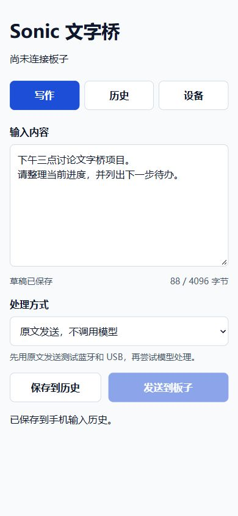
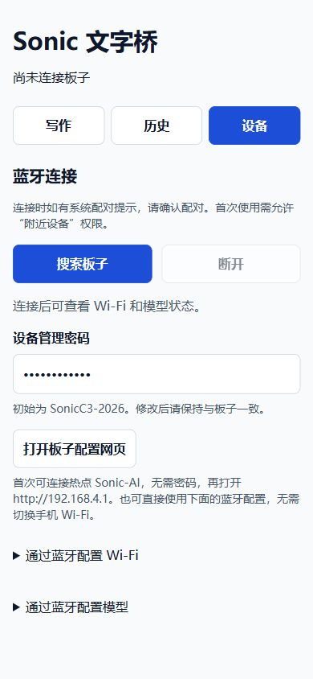
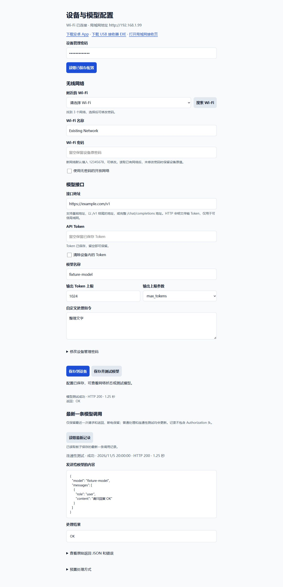
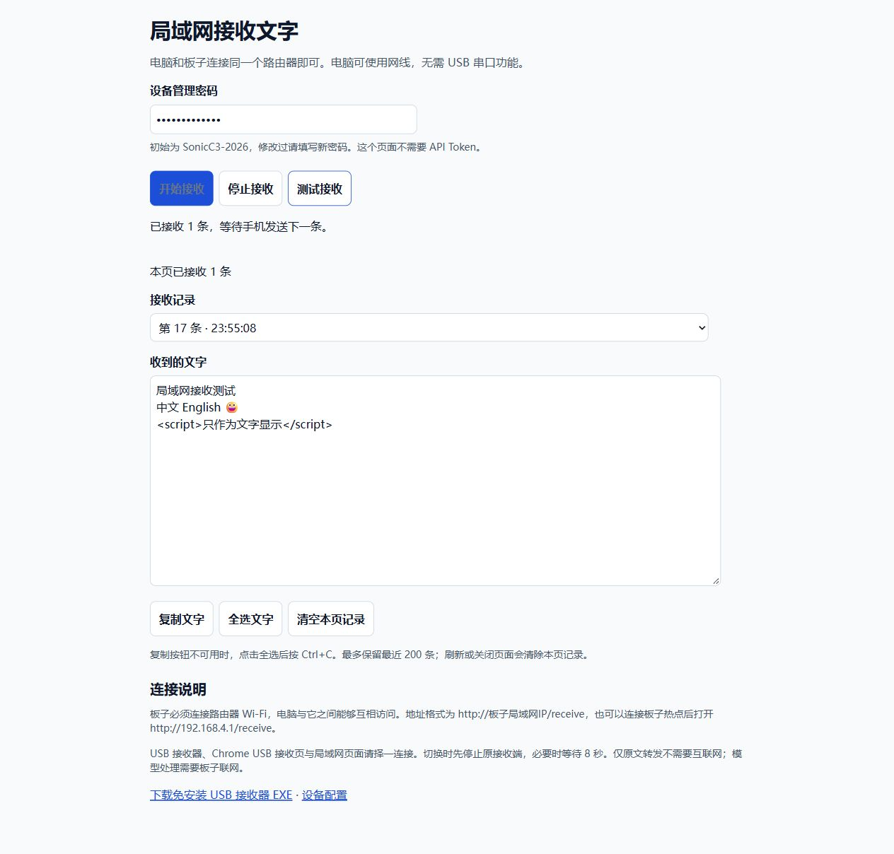

# Sonic AI 文字桥

用安卓手机输入和保存文字，通过 BLE 发给 ESP32-C3，再在电脑上接收。可直接转发原文，也可由板子连接 Wi-Fi，调用 OpenAI Chat Completions 兼容接口后发送处理结果。

[下载 Release](https://github.com/sonicmingit/espc3-text/releases/latest) · [使用指南](ai-bridge/dist/使用说明.md) · [构建与刷机](docs/BUILD.md) · [协议](docs/PROTOCOL.md) · [验证范围](docs/VALIDATION.md)

## 当前版本

| 组件 | 版本 | 内容 |
| --- | --- | --- |
| ESP32-C3 固件 | 2.2.0 | BLE 输入、Wi-Fi 配置、模型处理、USB / 局域网接收 |
| 安卓手机端 | 2.0.0 | Android 8.0+，草稿、100 条输入历史、BLE 连接和配置 |
| Windows 接收器 | 1.0.0 | 32 位免安装 EXE，原生 Win32，无 .NET / Python 运行时依赖 |
| 浏览器接收端 | 随固件 2.2.0 | 局域网页面，以及 Chrome / Edge 的 USB 页面 |

发布包提供当前开发版本。固件 2.2.0 已编译；当前实物板最后完成刷入和回归的是 2.1.0。2.2.0 的新增传输仍需刷入后实测。XP、Win 7 和目标安卓手机未完成真机验证，详见[验证范围](docs/VALIDATION.md)。

## 可以怎样使用

```text
安卓手机：输入 / 保存 / 键盘语音输入
                 │ BLE
                 ▼
             ESP32-C3
        ┌────────┴─────────┐
        │ 原文直接转发     │ Wi-Fi → 兼容模型 API → 返回文字
        └────────┬─────────┘
                 ▼
   USB → Windows EXE 或 Chrome/Edge
   局域网 → 普通浏览器打开 /receive
```

- **离线 USB**：手机选择“原文发送”，板子无需连接 Wi-Fi、无需模型 Token。
- **局域网接收**：板子和电脑连接同一路由器，电脑可使用网线；不要求电脑支持 Web Serial。
- **模型处理**：支持润色、摘要、待办、英文翻译及自定义指令；地址、Token、模型 ID 可配置。
- **配置诊断**：搜索 2.4 GHz Wi-Fi、测试模型连通性、保存最新一次请求和返回。调用记录断电保留。

## 快速开始

1. 在 [Release](https://github.com/sonicmingit/espc3-text/releases/latest) 下载固件 ZIP 并按其中说明刷入 ESP32-C3。已有 2.1 配置时使用分段刷机脚本，保留 NVS 和 LittleFS。
2. 安装 `SonicTextBridge-v2.0.0.apk`。手机在 App“设备”页搜索并连接 **Sonic-AI**。初始设备管理密码是 `SonicC3-2026`。
3. 选择一种电脑接收方式：
   - USB：运行 `SonicTextReceiver-v1.0.0-x86.exe`，选择板子的实际 COM 口并连接。
   - 局域网：打开 `http://板子的局域网IP/receive`，填管理密码并开始接收。
   - Chrome / Edge USB：打开 `电脑接收.html` 并连接串口。
4. 手机选择“原文发送”，输入文字并发送。电脑收到后可复制；EXE 还可保存 UTF-8 文本。
5. 需要模型处理时，连接开放热点 **Sonic-AI**，打开 `http://192.168.4.1/` 配置 Wi-Fi 和模型；也可使用 App 中的 BLE 配置。

热点没有密码；管理密码用于配置和发送授权，两者不同。新选择的路由器 Wi-Fi 密码默认填入 `12345678`，请按实际网络修改。USB 和局域网接收端同时只连接一个，切换时先断开，必要时等待 8 秒。

XP 若无法识别板子的 USB 串口，可优先使用局域网接收方式。EXE 的 PE 系统版本目标为 XP 5.1，不代表所有旧系统和 USB 驱动均已验证。此项目接收文字后由用户复制，不模拟键盘自动输入到其他软件；当前也不包含录音转写模块。

## 界面截图

以下为当前源码页面在本地测试夹具中的截图，使用合成文字、虚构网络和模拟模型返回；手机截图展示 APK 内使用的 HTML 界面，不是安卓真机截图。

| 手机输入 | 手机设备管理 |
| --- | --- |
|  |  |

<details>
<summary>设备配置：Wi-Fi 搜索、模型测试、最新调用记录</summary>



</details>



## 源码目录

```text
ai-bridge/
  android/          Java BLE 客户端、WebView 页面、APK 构建脚本
  firmware/         ESP32-C3 固件、配置页、局域网接收页
  receiver-win32/   原生 C 接收器和 JSON 解析器
  dist/             浏览器 USB 页面与使用说明
  tools/            本地 UI 夹具和历史硬件测试脚本
docs/               构建、协议、验证说明及截图
tools/              发布包生成脚本与刷机脚本
```

构建生成的头文件、二进制、SDK、签名私钥和原始测试日志不进入 Git。二进制在 Release 附件中发布，并提供 SHA-256 校验和。第三方组件及许可证见 [THIRD_PARTY_NOTICES.md](THIRD_PARTY_NOTICES.md)。
